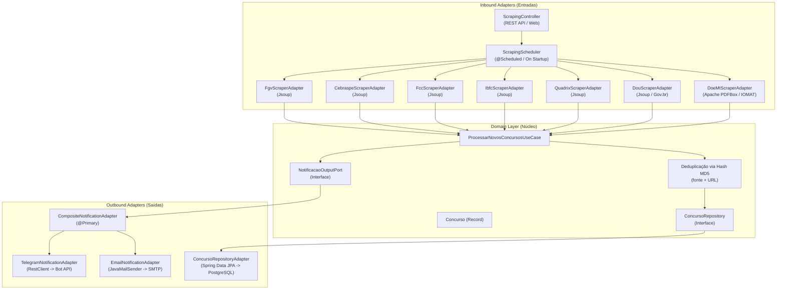

# 📢 Concursos News — Monitor Automatizado de Concursos Públicos

Sistema em **Java 21** e **Spring Boot 3** para monitoramento automatizado e em tempo real de editais de concursos públicos regionais (com foco no Centro-Oeste / Mato Grosso e âmbito Nacional), utilizando **Web Scraping**, **PDF Scraping**, **Ports & Adapters (Hexagonal Architecture)** e **Composite Pattern**.

---

## 🏛️ Arquitetura do Sistema

A aplicação foi projetada desacoplando 100% as regras de negócio da infraestrutura externa:



---

## 📑 Fontes de Monitoramento Ativas

| Fonte | Tipo | Alvo / Estratégia | Cobertura |
|---|---|---|---|
| **FGV** | Web Scraping (HTML) | `https://conhecimento.fgv.br/concursos` | Nacional |
| **Cebraspe** | Web Scraping (HTML) | `https://www.cebraspe.org.br/concursos` | Nacional |
| **FCC** | Web Scraping (HTML) | `https://www.fcc.org.br/fcc/concursos-publicos` | Nacional |
| **IBFC** | Web Scraping (HTML) | `https://concursos.ibfc.org.br/index/abertos/` | Nacional |
| **Quadrix** | Web Scraping (HTML) | `https://quadrix.org.br/index/abertos/` | Nacional / Conselhos |
| **Instituto Selecon** | Web Scraping (HTML) | `https://selecon.org.br/concursos/` | Mato Grosso / Nacional |
| **DOU (Seção 3)** | Web Scraping (HTML) | `https://www.in.gov.br/consulta/-/buscar/dou` (busca parametrizada) | Nacional / MT |
| **DOE-MT** | PDF Scraping | `https://www.iomat.mt.gov.br/` (download diário + extração via PDFBox) | Mato Grosso / Regional |

---

## ⚡ Como Funciona a Deduplicação e Notificação

1. **Varredura**: O agendador dispara todos os scrapers habilitados.
2. **Geração de Hash MD5**: Cada edital/concurso gera um hash único baseado em `MD5(fonte + "::" + url)`.
3. **Verificação no Banco**: O Use Case consulta se o hash já existe no PostgreSQL:
   - Se **já existe**: O registro é considerado conhecido e ignorado silenciosamente.
   - Se **é novo**: O registro é persistido no banco com as flags `prioritario` e `tecnologia`.
4. **Filtro de Tecnologia da Informação (TI)**:
   - O sistema avalia se o concurso envolve cargos/perfis de TI (ex: *Analista de Sistemas, Tecnologia da Informação, Desenvolvedor, TI/T.I., Engenharia de Software, Ciência da Computação, Redes, Dados, Segurança da Informação, DevOps, etc.*).
   - Editais que **não** são de TI continuam arquivados no banco (para nunca serem reprocessados), mas **não geram notificações**.
5. **Envio Resiliente e Unificação de E-mails**:
   - Para evitar sobrecarga de e-mails, **cada ciclo de varredura dispara no máximo 2 e-mails**:
     1. **E-mail 1 (Prioritários)**: Concursos de TI em estados como MT, SC, PR, DF, GO.
     2. **E-mail 2 (Demais Estados / Nacional)**: Concursos de TI nas demais regiões.
   - **Template dos E-mails**: O conteúdo é renderizado em HTML moderno (com fallback em texto formatado), agrupado com destaque visual primeiro por **ESTADO (UF)** e depois por **BANCA ORGANIZADORA**, com links diretos para cada edital.
   - O Telegram recebe alertas individuais imediatos dos novos editais de TI com a tag `[CONCURSO TI]`.

---

## 🌐 Endpoints da API REST

A aplicação disponibiliza endpoints para monitoramento e acionamento manual na porta `8080`:

| Método | Endpoint | Descrição |
|---|---|---|
| `POST` | `/api/v1/scraping/executar` | Dispara imediatamente um ciclo de scraping em segundo plano |
| `GET` | `/api/v1/scrapers` | Lista todos os scrapers ativos na aplicação |
| `GET` | `/api/v1/concursos` | Lista todos os concursos persistidos (ordenados do mais recente) |
| `GET` | `/api/v1/concursos?tecnologia=true` | Filtra apenas concursos com vagas de TI |
| `GET` | `/api/v1/concursos?prioritario=true` | Filtra apenas concursos de estados prioritários |
| `GET` | `/api/v1/concursos?fonte=FGV` | Filtra concursos por banca/fonte |
| `GET` | `/api/v1/concursos?regiao=Mato Grosso` | Filtra concursos por região |

---

## ⚙️ Variáveis de Ambiente e Configuração

Defina as variáveis no seu ambiente ou em um arquivo `.env`:

### 1. Banco de Dados (PostgreSQL)
```bash
DATABASE_URL=jdbc:postgresql://localhost:5432/concursos_news
DATABASE_USER=postgres
DATABASE_PASSWORD=postgres
```

### 2. Telegram Bot
Para criar seu bot e obter as credenciais:
1. Abra o Telegram e fale com `@BotFather` para criar um bot e obter o `TOKEN`.
2. Envie uma mensagem para o seu bot ou crie um grupo e adicione-o.
3. Obtenha seu `CHAT_ID` falando com `@userinfobot` ou acessando `https://api.telegram.org/bot<TOKEN>/getUpdates`.
```bash
TELEGRAM_BOT_TOKEN=123456789:ABCdefGhIJKlmNoPQRstuvWxyz
TELEGRAM_CHAT_ID=-1001234567890
```

### 3. E-mail (Gmail SMTP)
Para usar o Gmail:
1. Ative a **Verificação em 2 etapas** na sua conta Google.
2. Vá em **Segurança > Senhas de App** e gere uma nova senha de app para "E-mail".
```bash
EMAIL_HOST=smtp.gmail.com
EMAIL_PORT=587
EMAIL_USERNAME=seu-email@gmail.com
EMAIL_PASSWORD=sua-senha-de-app-de-16-digitos
NOTIFICATION_EMAIL_TO=destinatario@gmail.com
```

### 4. Controle de Filtro de TI e Prioridade de Estados
```bash
# Filtro de Tecnologia da Informação (TI)
# Quando habilitado (padrão: true), dispara notificações APENAS para concursos com cargos de TI
MONITOR_FILTRO_TI_HABILITADO=true
# Termos adicionais customizados opcionais (separados por vírgula)
MONITOR_TERMOS_TI_CUSTOMIZADOS=geoprocessamento,bioinformatica

# Estados prioritários (separados por vírgula). Todos os editais são coletados,
# mas editais destes estados são notificados primeiro e com destaque visual (⭐)
MONITOR_ESTADOS_PRIORITARIOS=MT,SC,PR,DF,GO

# Executa uma rodada imediatamente ao iniciar a aplicação (útil para testes)
SCRAPER_EXECUTE_ON_STARTUP=true

# Expressão Cron para o ciclo regular (padrão: a cada 3 horas)
SCRAPER_CRON=0 0 */3 * * *

# Habilitar ou desabilitar scrapers individualmente
SCRAPER_FGV_ENABLED=true
SCRAPER_CEBRASPE_ENABLED=true
SCRAPER_FCC_ENABLED=true
SCRAPER_IBFC_ENABLED=true
SCRAPER_QUADRIX_ENABLED=true
SCRAPER_SELECON_ENABLED=true
SCRAPER_DOU_ENABLED=true
SCRAPER_DOE_MT_ENABLED=true
```

---

## 🚀 Como Executar

### 1. Subir o PostgreSQL via Docker
```bash
docker run -d --name concursos-pg \
  -e POSTGRES_DB=concursos_news \
  -e POSTGRES_USER=postgres \
  -e POSTGRES_PASSWORD=postgres \
  -p 5432:5432 postgres:16
```

### 2. Executar a Aplicação
```bash
# No diretório raiz do projeto:
mvn spring-boot:run
```

Ou com variáveis inline:
```powershell
$env:TELEGRAM_BOT_TOKEN="seu_token"
$env:TELEGRAM_CHAT_ID="seu_chat_id"
$env:SCRAPER_EXECUTE_ON_STARTUP="true"
mvn spring-boot:run
```

### 3. Disparar uma Varredura Manual
```bash
curl -X POST http://localhost:8080/api/v1/scraping/executar
```

---

## 🔍 Entendendo os Logs da Aplicação

Ao iniciar a aplicação com sucesso, você observará:
```log
Started MonitorApplication in 9.186 seconds
```

Quando o ciclo de scraping é disparado (automaticamente ou via endpoint):
```log
=== Ciclo de scraping iniciado ===
Executando scraper: [FGV]
[FGV] Iniciando scraping em https://conhecimento.fgv.br/concursos
[FGV] 25 concurso(s) encontrado(s).
...
Total de candidatos coletados: 85. Iniciando processamento...
Novo concurso detectado e notificado: [TJ-MT Oficial de Justiça] | Fonte: FGV | Região: Nacional
Enviando notificação via Telegram para o chat [123456789] sobre o concurso [TJ-MT Oficial de Justiça]
Notificação via Telegram enviada com sucesso
...
=== Ciclo de scraping concluído ===
```

Nas execuções subsequentes:
```log
Concurso já conhecido, ignorando: [TJ-MT Oficial de Justiça]
Processamento concluído: 0 novo(s) de 85 candidato(s).
```
Isso confirma que a deduplicação impedirá qualquer notificação duplicada.
