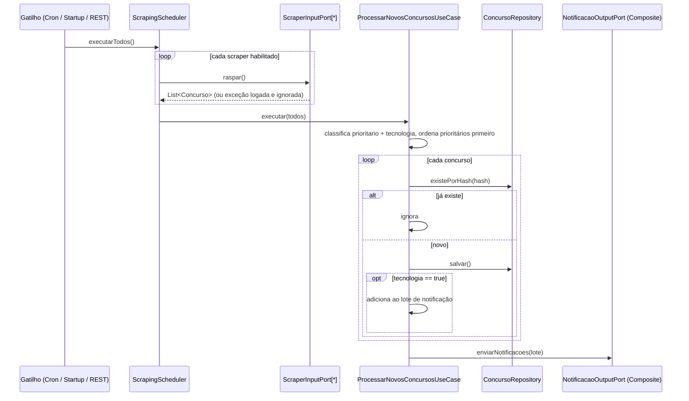
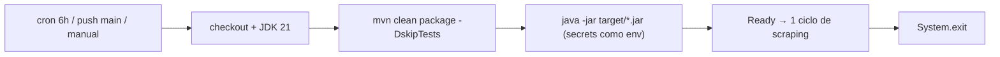
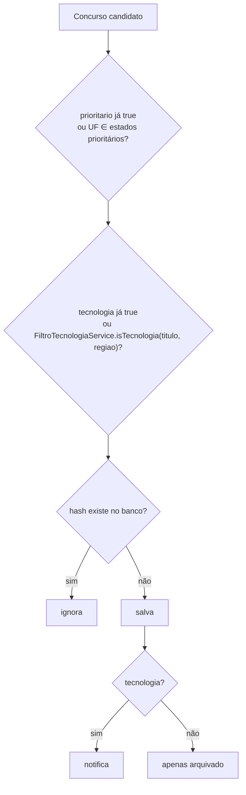
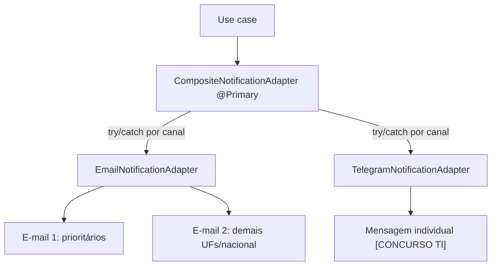

# Fluxos do sistema

## 1. Ciclo de scraping (fluxo principal)

## 2. Gatilhos
| Gatilho | Onde | Detalhe |
|---|---|---|
| Cron | `@Scheduled(cron="${scraper.cron}")` | default a cada 3h (app contínuo) |
| Startup | `@EventListener(ApplicationReadyEvent)` | se `scraper.executar-no-startup=true` |
| Encerramento | mesmo listener | se `scraper.finalizar-apos-execucao=true` → `SpringApplication.exit` + `System.exit` |
| REST | `POST /api/v1/scraping/executar` | dispara em background |
| GitHub Actions | `maven-publish.yml` | cron 6h UTC, push em `main`, manual; usa startup+finalizar |

## 3. Modo GitHub Actions (produção)

## 4. Classificação de um concurso

Identificação de UF (`EstadoPrioritarioService.identificarUf`): região de 2 letras → nome por extenso (maior primeiro) → sigla isolada com regex `\b`.

## 5. Notificação

- E-mail: HTML agrupado por UF → banca, com fallback texto. Máx. 2 e-mails por ciclo.
- Composite exclui a si mesmo da lista de adapters (evita recursão).

## 6. Scrapers por tipo
- **HTML (Jsoup):** FGV, Cebraspe, FCC, IBFC, Quadrix, Selecon, DOU (busca parametrizada por `keywords`).
- **PDF (PDFBox):** DOE-MT — baixa PDF diário do IOMAT, extrai texto, procura `keywords`.
- **Stub:** GazetaMt (não registrado como bean).
Contrato: `ScraperInputPort { String identificador(); List<Concurso> raspar(); }`.

## 7. Modelo de dados (`concurso`)
Campos: `id`(UUID/36), `titulo`(500), `banca`(200), `link_edital`(2000), `regiao`, `data_criacao`, `fonte`, `hash_deduplicacao` (único, usado para dedupe), `prioritario`, `tecnologia`. Ver `schema.sql` e `ConcursoEntity`.
