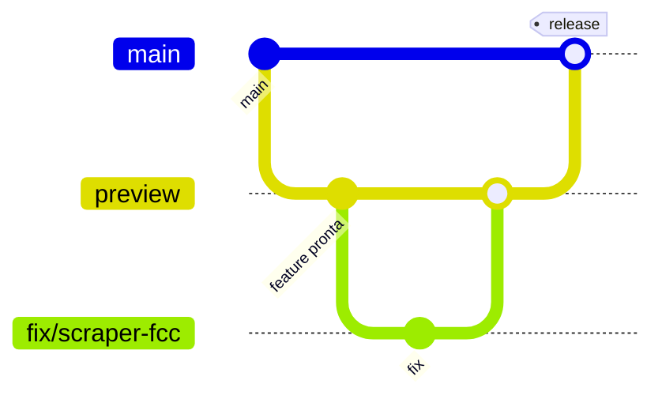

# Estratégia de Git: branches, commits e Pull Requests

## 1. Branches


| Branch | Papel | Regras |
|---|---|---|
| `main` | Produção. **Não é alterada diretamente.** | Só recebe merge de `preview` quando a funcionalidade está pronta e validada. Cada merge dispara o workflow real (banco, e-mail, Telegram). |
| `preview` | Integração / homologação | Recebe PRs das branches curtas. Merge em `main` via PR `preview → main`. |
| `<tipo>/<descricao>` | Pequenas modificações | Criada **a partir de `preview`**, PR **para `preview`**, apagada após merge. |

### Nomenclatura das branches curtas
`<tipo>/<descricao-curta-em-kebab-case>` — tipos iguais aos de commit:
`feat/scraper-gazeta-mt` · `fix/scraper-fcc-seletor` · `refactor/controller-usa-porta` · `docs/context-md` · `test/filtro-ti` · `chore/atualiza-jsoup` · `ci/roda-testes-no-pr`

### Fluxo
```bash
git switch preview && git pull
git switch -c fix/scraper-fcc-seletor
# ... trabalho, commits ...
git push -u origin fix/scraper-fcc-seletor
# PR: fix/scraper-fcc-seletor → preview   (squash merge)

# Funcionalidade pronta em preview:
# PR: preview → main   (merge commit, NÃO squash, para manter histórico)
```
Proteções recomendadas no GitHub: `main` e `preview` protegidas, PR obrigatório, build/testes verdes, sem force-push. Em `main` permitir merge apenas de `preview`.

### Estratégia de merge
- `branch curta → preview`: **Squash and merge** (1 commit limpo com título convencional).
- `preview → main`: **Merge commit** (preserva histórico; evita divergência entre `main` e `preview`).
- Após release, se `main` tiver commit exclusivo (ex.: hotfix), trazer de volta: `git switch preview && git merge main`.
- Hotfix urgente em produção: branch `fix/...` a partir de `preview` mesmo assim, PR para `preview`, e então `preview → main` (mantém a regra de que `main` nunca é editada direto).

## 2. Mensagens de commit (Conventional Commits, em português)
Formato:
```
<tipo>(<escopo opcional>): <descrição imperativa, minúscula, sem ponto, ≤ 72 caracteres>

[corpo opcional: o QUÊ e o PORQUÊ, não o como; quebra em ~72 colunas]

[rodapé opcional: Closes #12 | BREAKING CHANGE: ...]
```

| Tipo | Uso |
|---|---|
| `feat` | nova funcionalidade (ex.: nova fonte/scraper, novo endpoint) |
| `fix` | correção de bug (ex.: seletor quebrado) |
| `refactor` | mudança sem alterar comportamento |
| `test` | testes |
| `docs` | documentação (README, CONTEXT.md, docs/) |
| `build` | pom.xml, dependências |
| `ci` | GitHub Actions |
| `chore` | tarefas gerais (config, .gitignore) |
| `perf` | desempenho |
| `revert` | reverte commit |

**Escopos sugeridos:** `scraper`, `fcc`, `cebraspe`, `dou`, `doe-mt`, `notificacao`, `email`, `telegram`, `dominio`, `api`, `scheduler`, `db`, `actions`.

Exemplos:
```
feat(scraper): adiciona scraper da Gazeta MT
fix(fcc): corrige seletor da listagem de concursos
fix(doe-mt): ignora PDFs sem texto extraível
refactor(api): controller passa a usar ConcursoRepository
test(dominio): cobre sigla SE em EstadoPrioritarioService
ci(actions): executa mvn test em pull requests
docs: adiciona CONTEXT.md e guia de git workflow
feat(db)!: adiciona coluna data_edital

BREAKING CHANGE: requer coluna nova no banco de produção (ddl-auto=update cria).
```
Regras: um commit = uma mudança lógica; nunca commitar segredos; evitar mensagens como "ajustes" / "fix".
Observação: o histórico atual mistura `build(githubActions)` e mensagens livres — a partir de agora usar `ci(actions)` para workflows.

## 3. Pull Requests
### Título (vira o commit do squash)
Mesmo formato do commit: `<tipo>(<escopo>): <descrição>`
- `branch curta → preview`: `fix(fcc): corrige seletor da listagem`
- `preview → main`: `release: <resumo das funcionalidades>` (ex.: `release: scraper Gazeta MT e filtro de TI customizável`)

### Descrição
Usar o template [`.github/pull_request_template.md`](../.github/pull_request_template.md) (carregado automaticamente pelo GitHub). Seções: Resumo, Motivação/Contexto, Mudanças, Como testar, Impacto (banco/env vars/workflow), Checklist e Issues relacionadas.

### Checklist de review
- [ ] Base correta (`preview`; só `preview → main` vai para `main`)
- [ ] `mvn -B test` passando
- [ ] Sem segredos; novas env vars documentadas (`application.yml`, README, workflow secrets)
- [ ] `CONTEXT.md`/`docs/` atualizados se mudou fluxo ou regra
- [ ] Impacto em dedupe/banco avaliado

## 4. Instruções para agentes de IA
1. Sempre `git switch preview && git pull` antes de criar branch.
2. Nunca `commit`/`push` em `main` ou `preview`; sempre branch curta + PR.
3. Um PR por assunto, pequeno e focado.
4. Commits e PR em português seguindo este documento.
5. Não fazer merge em `main` sem pedido explícito do usuário.
